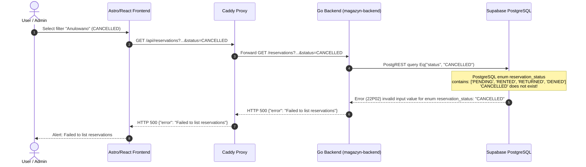
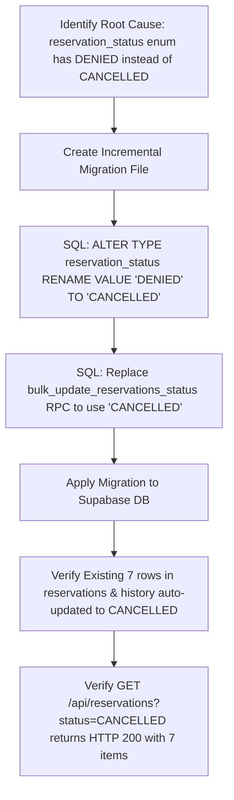

# Investigation Report: HTTP 500 Error on Filtering Cancelled Reservations (v0.3.0)

**Date**: 2026-10-14  
**Target Environment**: `bill164` (magazyn.bystrze.org)  
**Release Version**: `v0.3.0`  
**Report File**: `.ai/investigation_reservation_status_cancelled_500.md`  

---

## 1. Incident Overview

When navigating to `/admin/reservations` (or user reservations) and filtering reservations by status **"Anulowano"** (`CANCELLED`), the frontend triggers:
```http
GET https://magazyn.bystrze.org/api/reservations?page=1&per_page=25&sort=created_desc&scope=all&status=CANCELLED
```
The server responds with an **HTTP 500 (Internal Server Error)**, displaying an alert in the UI:
> `Failed to list reservations`

---

## 2. Server Logs Investigation (`bill164`)

Inspecting the container logs on `bill164` (`docker logs magazyn-backend`):

```json
{"time":"2026-10-14T15:08:55.326963169Z","level":"DEBUG","msg":"Incoming request: GET /reservations","trace_id":"667b8da7-f8e0-45ce-bb00-157ee3cdf1c6"}
{"time":"2026-10-14T15:08:55.467651408Z","level":"DEBUG","msg":"Reservations list - Role: super_admin, Scope: 0xc000403a50, UserID: 5cc60444-fc26-4ecc-bdfd-f65d3ebc03e2","username":"Gons","trace_id":"667b8da7-f8e0-45ce-bb00-157ee3cdf1c6"}
{"time":"2026-10-14T15:08:55.550988697Z","level":"ERROR","msg":"Failed to list reservations: (22P02) invalid input value for enum reservation_status: \"CANCELLED\"","username":"Gons","trace_id":"667b8da7-f8e0-45ce-bb00-157ee3cdf1c6"}
{"time":"2026-10-14T15:08:55.551195153Z","level":"ERROR","msg":"List error: Failed to list reservations","username":"Gons","trace_id":"667b8da7-f8e0-45ce-bb00-157ee3cdf1c6"}
```

**Key Error Details**:
* **PostgreSQL Error Code**: `22P02` (`invalid_text_representation`)
* **Message**: `invalid input value for enum reservation_status: "CANCELLED"`

---

## 3. Architecture & Error Flow



---

## 4. Root Cause Analysis

### A. The Discrepancy

Querying the production database directly on `bill164`:
```sql
SELECT enumlabel 
FROM pg_enum 
JOIN pg_type ON pg_enum.enumtypid = pg_type.oid 
WHERE typname = 'reservation_status';
```
**Database Result**:
```
 enumlabel 
-----------
 PENDING
 RENTED
 RETURNED
 DENIED
```

However, across the repository:
* **Frontend types** (`frontend/src/db/database.types.ts`): `"PENDING" | "RENTED" | "RETURNED" | "CANCELLED"`
* **Backend constants** (`backend/internal/constants/constants.go`): `ReservationStatusCancelled = "CANCELLED"`
* **Database documentation** (`documentation/database/db-doc.md`): `reservation_status`: `PENDING`, `RENTED`, `RETURNED`, `CANCELLED`
* **Base schema migration file** (`supabase/migrations/20251120194634_base.sql`): `CREATE TYPE reservation_status AS ENUM ('PENDING', 'RENTED', 'RETURNED', 'CANCELLED');`

### B. Why This Happened (Git History)

In commit `4973cfd3` (*"refactor(backend): architecture, dead code removal and layering enforcement (#215)"*):
```
* refactor(status): align reservation and credit request statuses
- Replace DENIED with CANCELLED across db, Go backend, and frontend.
- Align credit_request_status enum to lowercase values.
- Update base migrations and RPCs directly without new migration files.
- Update backend services, integration tests, and Playwright E2E suites.
```

**The fatal mistake**:
The author updated the existing historical migration file `20251120194634_base.sql` directly instead of adding a new migration file.
Because the production Supabase database had already executed version `20251120194634` when the database was created, Supabase migration tracking (`supabase_migrations.schema_migrations`) considered `20251120194634` already applied.

As a result:
1. Fresh environments / local containers created from scratch got `CANCELLED`.
2. The live production database remained on `DENIED`.
3. An earlier migration (`20260925230632_add_cancelled_status.sql`) that previously handled `ALTER TYPE` was removed during commit cleanup.

---

## 5. Live Production Data Assessment

Inspection of records on the live database:

1. **`reservations` table**:
   ```sql
   SELECT status, count(*) FROM reservations GROUP BY status;
   ```
   * `RETURNED`: 23
   * `PENDING`: 17
   * `DENIED`: 7 (legacy cancelled reservations)

2. **`reservation_history` table**:
   ```sql
   SELECT status, count(*) FROM reservation_history GROUP BY status;
   ```
   * `PENDING`: 49
   * `RETURNED`: 23
   * `DENIED`: 7

3. **PostgreSQL Stored Procedures**:
   `bulk_update_reservations_status` currently has hardcoded logic checking `IF p_status = 'DENIED'`.

---

## 6. Proposed Fix Plan



### Dry Run Verification Performed:
A transactional dry-run test (`BEGIN ... ROLLBACK;`) was executed against the database:
```sql
BEGIN;
ALTER TYPE reservation_status RENAME VALUE 'DENIED' TO 'CANCELLED';
SELECT status, count(*) FROM reservations GROUP BY status;
ROLLBACK;
```
**Outcome**:
* Completed successfully without locks or errors.
* Automatically converted all 7 `DENIED` rows to `CANCELLED` in both `reservations` and `reservation_history`.
* All queries filtering by `status = 'CANCELLED'::reservation_status` succeeded instantly.

### Implementation Action Items:
1. **Create migration file** `supabase/migrations/20261014173000_rename_denied_to_cancelled_reservation_status.sql`:
   ```sql
   -- Migration: Rename reservation_status enum DENIED to CANCELLED
   -- Description: Aligns production database enum with backend and frontend code

   ALTER TYPE reservation_status RENAME VALUE 'DENIED' TO 'CANCELLED';

   -- Update bulk_update_reservations_status RPC function
   CREATE OR REPLACE FUNCTION bulk_update_reservations_status(
       p_reservation_ids UUID[], 
       p_status TEXT, 
       p_admin_id UUID
   ) RETURNS JSONB LANGUAGE plpgsql SECURITY DEFINER SET search_path = public AS $body$
   DECLARE 
       v_res_id UUID; 
       v_reservation reservations%ROWTYPE; 
       v_updated_count INTEGER := 0; 
       v_refund_count INTEGER := 0; 
       v_refund_amount INTEGER; 
       v_credit_per_day INTEGER; 
       v_days INTEGER; 
       v_skipped_ids UUID[] := '{}';
   BEGIN
       PERFORM set_config('app.changed_by_user_id', p_admin_id::TEXT, true);
       FOREACH v_res_id IN ARRAY p_reservation_ids LOOP
           SELECT * INTO v_reservation FROM reservations WHERE id = v_res_id FOR UPDATE;
           IF v_reservation.id IS NULL THEN 
               v_skipped_ids := array_append(v_skipped_ids, v_res_id); 
               CONTINUE; 
           END IF;

           -- Skip refunds for free reservations
           IF p_status = 'CANCELLED' AND v_reservation.status != 'CANCELLED' AND NOT v_reservation.is_free THEN
               SELECT et.credit_cost_per_day INTO v_credit_per_day 
               FROM equipment e 
               JOIN equipment_types et ON e.type_id = et.id 
               WHERE e.id = v_reservation.equipment_id;
               
               v_days := (v_reservation.end_date - v_reservation.start_date) + 1; 
               v_refund_amount := v_days * v_credit_per_day;
               
               IF v_refund_amount > 0 THEN
                   UPDATE profiles SET credit_balance = credit_balance + v_refund_amount WHERE id = v_reservation.user_id;
                   INSERT INTO credit_history (user_id, amount, reason, description, reservation_id, author_id) 
                   VALUES (v_reservation.user_id, v_refund_amount, 'reservation_refund', 'Refund', v_res_id, p_admin_id);
                   v_refund_count := v_refund_count + 1;
               END IF;
           END IF;

           UPDATE reservations SET status = p_status::reservation_status, updated_at = NOW() WHERE id = v_res_id;
           v_updated_count := v_updated_count + 1;
       END LOOP;
       RETURN jsonb_build_object('updated_count', v_updated_count, 'skipped_ids', v_skipped_ids);
   END; $body$;
   ```
2. **Apply migration to Supabase DB** using Supabase CLI or psql migration runner.
3. **Verify** filtering `status=CANCELLED` in frontend returns HTTP 200 with the 7 records.
