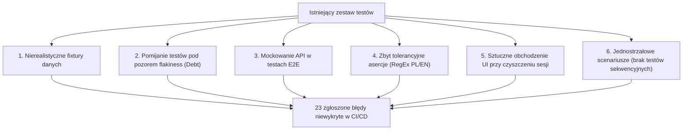
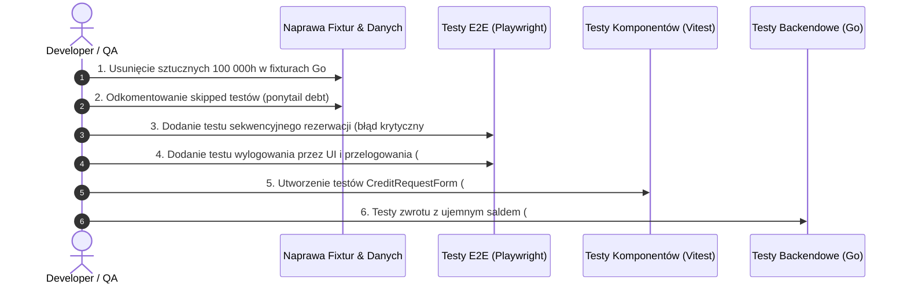

# Raport Audytu Testów i Analizy Flakiness (Magazyn Bystrza)

Data audytu: **19 października 2026**  
Plik źródłowy zgłoszeń: `C:\Users\mateo\Downloads\Testy Magazyn Bystrza.md` (23 zgłoszenia z dnia 18.10.2026)  
Cel: **Analiza przyczyn pominięcia błędów przez istniejące testy (flakiness / blind spots) oraz zestawienie scenariuszy testowych do pełnego pokrycia regresyjnego.**

---

## 1. Podsumowanie Wykonawcze

Repozytorium posiada rozbudowany zestaw testów:
* **Backend**: Testy jednostkowe i integracyjne w Go (`backend/internal/...`) z bazą Supabase.
* **Frontend Unit/Component**: Vitest i React Testing Library (`frontend/src/...`).
* **E2E**: Playwright z izolacją workerów i testowymi użytkownikami (`frontend/e2e/...`).

Pomimo tego, aż **23 błędy (w tym 1 krytyczny)** trafiły do testów manualnych. Główną przyczyną nie jest brak narzędzi testowych, lecz **systemowe wady w konstrukcji istniejących testów**:



---

## 2. Główne Przyczyny Niewykrycia Błędów (Flakiness & Test Blind Spots)

### A. Nierealistyczne fixtury danych (Overly Generous Fixtures)
* **Plik**: `backend/internal/service/reservation/reservation_integration_fixture_test.go` (linie 90-92)
* **Problem**: W setupie testów integracyjnych każdemu użytkownikowi na sztywno ustawiane jest saldo **`100 000` godzinek**.
* **Konsekwencja**: Żaden test integracyjny ani backendowy nie testował zachowania systemu przy zerowym saldzie, niewystarczających środkach czy ujemnym bilansie przy zwrocie po terminie.

### B. Wyłączanie testów z powodu niestabilności (`ponytail: DEBT`)
* **Plik**: `frontend/e2e/tests/admin/equipment.spec.ts` (linia 27)
* **Problem**: W kodzie znajduje się komentarz: `// ponytail: DEBT - edit/archive tests skipped due to flakiness`.
* **Konsekwencja**: Całkowity brak testów E2E dla edycji, archiwizacji, usuwania i zmiany statusu sprzętu. Błędy związane z archiwizacją, edycją i brakiem spójności statusów przeszły niezauważone.

### C. Zastępowanie prawdziwego backendu mockami w testach E2E
* **Plik**: `frontend/e2e/tests/credits/history.spec.ts` (linie 76-82)
* **Problem**: Test E2E przechwytuje zapytania do `**/api/credits/history*` i zwraca zahardkodowany obiekt `MOCK_HISTORY`.
* **Konsekwencja**: Test E2E stał się w rzeczywistości testem statycznego szablonu HTML, nie weryfikując ani integracji z bazą, ani odświeżania salda po rezerwacji.
* Ponadto komponent wnioskowania o godzinki (`CreditRequestForm.tsx`) ma **0 testów jednostkowych i 0 testów E2E**.

### D. Zbyt luźne asercje językowe (Ukrywanie wycieków języka angielskiego)
* **Pliki**: `frontend/e2e/tests/reservation-creation.spec.ts` (linia 70), `admin/reservation-management.spec.ts` (linia 118)
* **Problem**: Asercje akceptują napisy w obu językach, np. `getByRole("heading", { name: /equipment|sprzęt|inwentarz/i })` lub `toContainText(/Anulowan[ao]|Cancelled/i)`.
* **Konsekwencja**: Test przechodzi na zielono niezależnie od tego, czy interfejs wyświetla się po polsku, czy po angielsku.

### E. Sztuczne czyszczenie przeglądarki omijające UI
* **Plik**: `frontend/e2e/tests/auth/login.spec.ts` (linie 54-57)
* **Problem**: Zamiast kliknąć przycisk "Wyloguj" w menu użytkownika, test wykonuje:
  ```ts
  await page.request.post("/api/auth/logout");
  await page.context().clearCookies();
  await page.evaluate(() => localStorage.clear());
  ```
* **Konsekwencja**: Ukryto błąd wycieku stanu i ciasteczek sesyjnych przy przelogowywaniu użytkowników w ramach tej samej przeglądarki.

### F. Jednostrzałowość testów rezerwacji (Brak testów sekwencyjnych)
* **Plik**: `frontend/e2e/tests/reservation-creation.spec.ts`
* **Problem**: Test tworzy dokładnie 1 rezerwację i w `afterEach` natychmiast przywraca saldo w bazie przez Supabase Admin.
* **Konsekwencja**: Błąd **krytyczny** (nieodświeżone saldo godzinek na froncie przy drugiej rezerwacji w tej samej sesji) był niemożliwy do wykrycia, bo test nigdy nie tworzył dwóch rezerwacji pod rząd.

---

## 3. Szczegółowa Analiza 23 Zgłoszeń i Matryca Brakujących Testów

| Nr | Obszar | Opis błędu | Dlaczego istniejące testy go nie złapały? | Poziom testu | Proponowany scenariusz testowy |
| :--- | :--- | :--- | :--- | :--- | :--- |
| **1** | Rezerwacja | Komunikaty w języku angielskim (np. w koszyku) | Asercje E2E nie sprawdzają tekstów toastów ani komunikatów błędów pod kątem słownika PL (`ERROR_START_DATE_PAST` itp.). | E2E / Component | Sprawdzenie komunikatów walidacji koszyka przy konfliktach i błędnych datach – asercja wyłącznie na język polski. |
| **2** | Zarządzanie rezerwacją | Blokada zwrotu sprzętu przy minusowych godzinkach | `ReturnWithDatesDialog.tsx` (l. 99-100) ma twardy warunek blokujący `adjustmentInfo.newBalance < 0`. Testy backendu zawsze dawały userowi `100 000` godzinek. | Go Integration + E2E | Użytkownik ma saldo 1 godzinki, rezerwacja przedłużona o 3 dni (koszt 6). Zwrot sprzętu z datą dzisiejszą musi się udać, a saldo spaść do `-5`. |
| **3** | Zarządzanie rezerwacją | Nadprogramowy przycisk, który nic nie wnosi | Testy E2E sprawdzają tylko istnienie konkretnego `data-testid`, ignorując liczbę i układ przycisków w akcjach. | Component (Vitest) | Test `ReservationStatusActions.test.tsx`: weryfikacja, że dla statusu PENDING/RENTED nie renderują się zduplikowane akcje. |
| **4** | Zarządzanie rezerwacją | Zunifikowanie przycisków | Brak testów sprawdzających spójność wariantów (`variant="outline"`, `variant="default"`) dla akcji statusów. | Component | Test sprawdzający style i warianty przycisków w tabeli i widoku szczegółów rezerwacji. |
| **5** | Zarządzanie rezerwacją | Brak miniaturki zdjęcia w szczegółach rezerwacji | Komponent `ReservationDetailsView.tsx` nie posiadał testu jednostkowego; E2E sprawdzał tylko nagłówki i daty. | Component | Test sprawdzający, czy przy obecnym `imageUrl` w obiekcie rezerwacji element `` renderuje się z poprawnym atrybutem `src`. |
| **6** | Zarządzanie sprzętem | Feature upgrade: dodawanie usterek/komentarzy przy zwrocie | Brak funkcjonalności i brak testu w dialogu zwrotu. | E2E + Go Integration | Formularz zwrotu: pole na komentarz/usterkę -> zapis w tabeli `maintenance_logs` / `audit_trail` oraz opcjonalna zmiana statusu sprzętu na `needs_service`. |
| **7** | Zarządzanie rezerwacją | Status "W trakcie" dla daty przyszłej (powinno być "Przyszła") | Test `admin/reservation-management.spec.ts` (l. 192) na sztywno asertował `/W trakcie/i` dla daty z przyszłości! Test cementował błąd. | Component / Unit | Test funkcji formatującej status: dla `PENDING` z `start_date > today` zwraca etykietę "Przyszła", a dla `start_date <= today` "W trakcie". |
| **8** | Godzinki | Brak łatwo dostępnego salda na pasku (np. przy awatarze) | `UserHeader.tsx` ma `Badge` ukryty na ekranach `< sm` i ze sztywnym angielskim napisem `Credits: {creditBalance}` pobieranym jednorazowo z SSR. | Component | Test `UserHeader.test.tsx`: renderowanie odznaki salda w języku polskim ("Godzinki: X") i reaktywność na zmiany stanu. |
| **9** | Zarządzanie rezerwacją | Możliwość ustawienia daty wstecz / błędny komunikat braku godzinek | `cart-validation.ts` (l. 37) porównuje `start <= today` używając UTC vs lokalnej północy, przez co wybór dzisiejszej daty generuje błąd lub ujemne dni. | Unit (Vitest) | Test `date-utils.test.ts` i `cart-validation.test.ts`: test graniczny dla strefy czasowej UTC+1/UTC+2 o godzinie 00:01 i 23:59. |
| **10** | Rezerwacja (**KRYTYCZNY**) | Brak aktualizacji salda godzinek przy kolejnej rezerwacji | E2E testował tylko 1 rezerwację w teście. Saldo w nagłówku i formularzu pochodzi ze statycznego SSR `sessionInfo`, brak unieważnienia cache (React Query/SWR). | E2E (Playwright) | **Scenariusz sekwencyjny**: 1. Sprawdź saldo (np. 20h). 2. Zarezerwuj sprzęt za 10h. 3. Bez wylogowania przejdź od razu do ponownej rezerwacji. Saldo musi wynosić 10h. |
| **11** | Zarządzanie sprzętem | Sprzęt po angielsku | Fixtury testowe seedowały bazę angielskimi nazwami (`kayak`, `paddle`), a testy nie wymuszały słownika PL. | E2E | Weryfikacja katalogu sprzętu pod kątem polskich nazw kategorii i typów. |
| **12** | Zarządzanie sprzętem | Połączenie szczegółów i edycji | Testy edycji sprzętu w `admin/equipment.spec.ts` zostały zakomentowane (`ponytail: DEBT`). | E2E | Wejście w edycję sprzętu z widoku szczegółów lub wspólny formularz details/edit. |
| **13** | Zarządzanie sprzętem | Niejasny status zarchiwizowany/zablokowany (brak przywracania) | Brak testu na odwracalność archiwizacji; backend posiadał tylko jednokierunkowy `is_archived = true`. | Go Integration + E2E | Próba usunięcia/archiwizacji sprzętu: weryfikacja komunikatu ostrzegawczego oraz brak obietnicy możliwości przywrócenia, jeśli system tego nie wspiera. |
| **14** | Zarządzanie sprzętem | Unifikacja statusów "OK" i "Dostępne" oraz zielony kolor | W kodzie baza zwraca `ok`, filtr używa `Dostępne`, a badge używał domyślnego szarego stylu. | Component | Test komponentu statusu sprzętu: mapowanie `ok` -> etykieta "Dostępne" z zieloną klasą CSS (`bg-green-...`). |
| **15** | Zarządzanie użytkownikami | Unifikacja statusu ("Wyłączone" vs "Zablokowane") | Test w `admin/users.spec.ts` (l. 77) sprawdzał tylko wycinek tekstu `/Wyłączony/i`, brak weryfikacji spójności w komunikatach błędu logowania. | E2E | Zablokowanie użytkownika w panelu admina -> weryfikacja jednolitej nazwy statusu w tabeli oraz przy próbie logowania ("Konto zablokowane"). |
| **16** | Zarządzanie użytkownikami | Brak filtrowania po statusach użytkowników | Test `admin/users.spec.ts` testował wyłącznie wyszukiwanie tekstowe po emailu. | E2E | Filtrowanie listy użytkowników: wybór filtra "Zablokowani" -> tabela zawiera tylko rekordy z `is_enabled=false`. |
| **17** | Godzinki | Wnioskowanie: nie da się wybrać osób z listy | Komponent `CreditRequestForm.tsx` posiada **zero testów**. Błąd w selekcie/checkboxach nie był objęty żadnym testem automatycznym. | Component + E2E | Otwarcie formularza wnioskowania o godzinki -> załadowanie listy użytkowników -> wybór osoby, której pomagano -> zaznaczenie pomagających -> wysłanie. |
| **18** | Zarządzanie sprzętem | Brak edycji wpisu | Pominięty test w `admin/equipment.spec.ts`. | E2E | Edycja istniejącego przedmiotu (zmiana nazwy, opisu, typu) -> zapis -> weryfikacja zmienionych danych na liście. |
| **19** | Zarządzanie sprzętem | Niejasna zmiana statusu w menu akcji | Akcje statusu w tabeli sprzętu nie miały testów sprawdzających etykiety i dialogi potwierdzenia. | Component | Weryfikacja opcji w menu zmiany statusu sprzętu (Dostępny, W naprawie, Zepsuty). |
| **20** | Zarządzanie sprzętem | Rezerwacja w historii wisząca jako "w trakcie" po terminie | Brak asercji weryfikującej, czy rezerwacja z przeszłą datą bez zwrotu ma status oznaczający zaległość (overdue). | Backend + Component | Test historii sprzętu: rezerwacja z `end_date < today` i brakiem zwrotu powinna być wizualnie oznaczona jako "Przeterminowana" / "Do zwrotu". |
| **21** | Logowanie | Mignięcie strony logowania po kliknięciu magic linka | Test `auth/login.spec.ts` czeka z długim timeoutem na element końcowy, ignorując przejściowe stany widoku. | E2E | Test wymiany tokena: bezpośrednie wejście w magic link nie powinno renderować formularza logowania z pustymi polami przed przekierowaniem. |
| **22** | Logowanie | Brak możliwości ustawienia hasła (tylko magic link) | Testy E2E logowały użytkowników bezpośrednio przez API Supabase `signInWithPassword`, maskując brak interfejsu ustawiania hasła dla zwykłego usera. | E2E | Weryfikacja przepływu ustawiania / resetowania hasła w ustawieniach profilu użytkownika. |
| **23** | Logowanie | Wyciek sesji przy przelogowywaniu w tej samej przeglądarce | Test E2E sztucznie czyścił cookies i localStorage z poziomu Playwright API zamiast użyć przycisku wylogowania w UI. | E2E | **Test współdzielonej przeglądarki**: 1. Zaloguj jako User A. 2. Wyloguj przez UI. 3. Zaloguj jako User B w tym samym oknie. 4. Sprawdź, czy User B nie widzi danych Usera A. |

---

## 4. Rekomendacje Wdrożeniowe dla Zespołu QA i Dev



1. **Natychmiastowy priorytet (Krytyczny błąd salda #10)**:
   * Stworzyć test E2E w `frontend/e2e/tests/reservation-creation.spec.ts`, który wykonuje dwie rezerwacje pod rząd w jednej sesji użytkownika i sprawdza aktualność salda.
2. **Usunięcie długu testowego (`ponytail: DEBT`)**:
   * Przywrócić i ustabilizować pominięte testy w `admin/equipment.spec.ts` dotyczące edycji i archiwizacji sprzętu.
3. **Prawdziwy test wylogowania (#23)**:
   * Przepisać test wylogowania w `auth/login.spec.ts`, usuwając `context.clearCookies()` i opierając się wyłącznie na kliknięciu w menu UI.
4. **Pokrycie formularza wnioskowania (#17)**:
   * Dodać testy Vitest dla `CreditRequestForm.tsx` z mockami API symulującymi wybór użytkowników z listy.
5. **Obsługa ujemnego salda w Go (#2)**:
   * Zmienić fixtury testowe w `backend/internal/service/reservation/reservation_integration_return_test.go`, aby testowały zwrot przy braku wystarczających środków.
