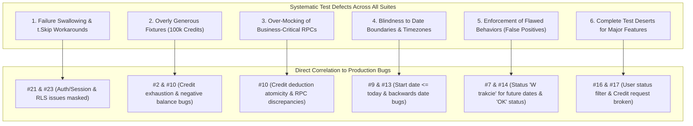
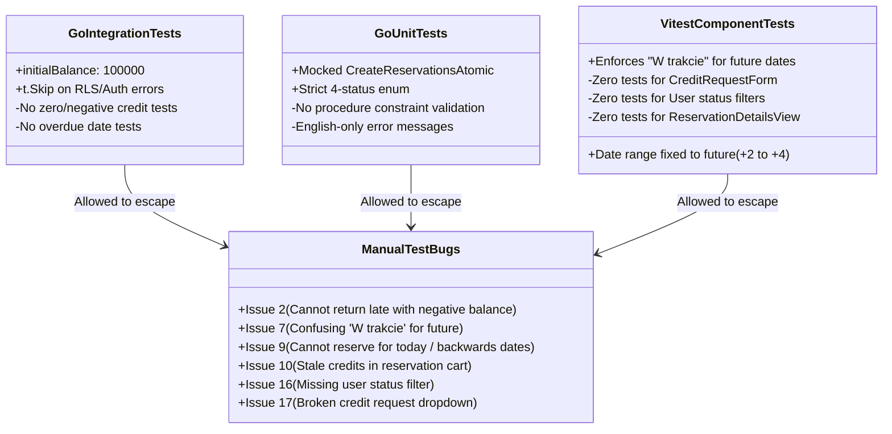

# Comprehensive Audit Report: Unit and Integration Test Suites

**Audit Date**: October 19, 2026  
**Target Repository**: `E:\bystrze\Magazyn` (Branch: `test/audit-report`)  
**Scope**: All backend (Go) unit/integration tests and frontend (Vitest / React Testing Library) unit/component tests.  
**Objective**: Verify whether the non-E2E test suites (unit and integration) suffer from the same systematic defects and blind spots that allowed the 23 manual test issues (from `Testy Magazyn Bystrza.md`) to escape to production.

---

## 1. Executive Summary

Our deep inspection reveals that **the unit and integration test suites suffer from the exact same systematic failure patterns as the E2E suite**:



---

## 2. Cross-Suite Issue Type Verification Matrix

| Issue Type Identified in E2E Audit | Present in Go Unit Tests? | Present in Go Integration Tests? | Present in Vitest Frontend Tests? | Evidence / File References |
| :--- | :---: | :---: | :---: | :--- |
| **Type 1: Failure Swallowing & `t.Skip` Defeatism** | ❌ | **YES (Critical)** | ❌ | `backend/internal/service/credit/credit_integration_test.go` (l. 147-154), `auth_service_integration_test.go` (l. 70-75) |
| **Type 2: Overly Generous & Unrealistic Fixtures** | ❌ (Mocked) | **YES (Critical)** | **YES** | `reservation_integration_fixture_test.go` (100,000 credits), `cart-validation.test.ts` (100 credits) |
| **Type 3: Over-Mocking Core Domain Logic** | **YES** | ❌ | **YES** | `reservation_service_create_test.go` (mocks `CreateReservationsAtomic`), `credit-request.transformer.test.ts` |
| **Type 4: Date, Timezone & Boundary Blindness** | **YES** | **YES** | **YES (Critical)** | `cart-validation.test.ts` (only tests +2 to +4 days), `date.go` vs `date-utils.ts` |
| **Type 5: Enforcing Flawed Status / UX Behaviors** | **YES** | **YES** | **YES (Critical)** | `ReservationTableRow.test.tsx` (asserts `PENDING` is `"W trakcie"` for future dates), `constants.go` |
| **Type 6: Test Deserts (Missing Test Files Entirely)** | **YES** | **YES** | **YES (Critical)** | `CreditRequestForm.tsx` (0 tests), user status filtering (0 tests), password management (0 tests) |
| **Type 7: English-Only Assertions & Missing i18n** | **YES** | **YES** | **YES** | Handlers assert raw English strings (`"Invalid reservation status"`, `"Reservation failed"`) |

---

## 3. Deep Dive into Test Suites

### 3.1. Go Integration Tests (`backend/internal/service/...`)

#### Finding 1: Swallowing Test Failures with `t.Skip` Instead of Fixing Bugs
* **File**: `backend/internal/service/credit/credit_integration_test.go` (Lines 147-154)
* **Code in Test**:
  ```go
  if !found {
      if len(resp.CreditHistory) == 0 {
          t.Skip("⚠️  Admin cannot view other user's credit history - RLS policy may need adjustment for admin role")
      }
      t.Logf("⚠️  Test entry not found in %d results - may have been filtered by RLS or timing issue", len(resp.CreditHistory))
  }
  ```
* **Impact**: When an admin queries a user's credit history and RLS or query logic fails, the test **does not fail**. It logs a warning or skips! This completely masked why admins and users saw mismatched credit histories (Issue #10, #14).
* **Similarly in Auth**: In `auth_service_integration_test.go` (Line 75), Supabase 400 errors are caught and swallowed with `t.Skip("Skipping test due to Supabase 400 error")`.

#### Finding 2: The "100,000 Credits" Blind Spot
* **File**: `backend/internal/service/reservation/reservation_integration_fixture_test.go` (Lines 90-92)
* **Code in Test**:
  ```go
  initialBalance := int32(100000)
  _, _, _ = fixture.client.From("profiles").Update(map[string]interface{}{"credit_balance": initialBalance}, "", "").Eq("id", fixture.testUserID).Execute()
  ```
* **Impact**: Every test runner starts with effectively infinite credits.
  - Zero tests check what happens when a user has `credit_balance = 0`.
  - Zero tests check what happens when an item return incurs extra charges that drive the balance negative.
  - As a result, the frontend check in `ReturnWithDatesDialog.tsx` (`if (adjustmentInfo.newBalance < 0) block return`) was never encountered in tests (Issue #2: "Przedłużenie dni przy braku godzinek - minusowe godzinki - aktualnie system nie pozwala zwrócić").

#### Finding 3: Missing Test Coverage for Negative / Extended Returns
* **File**: `backend/internal/service/reservation/reservation_integration_return_test.go`
* **Analysis**: `TestTS3_LateReturn_Succeeds` only tests updating status to `RETURNED`. It never attempts to modify the `end_date` to reflect the actual late return date or assert credit penalties.

---

### 3.2. Go Unit Tests (`backend/internal/handler/...` & `service/...`)

#### Finding 4: Mocking Out the Atomicity Logic
* **File**: `backend/internal/service/reservation/reservation_service_create_test.go` (Lines 118-126)
* **Code in Test**:
  ```go
  mockRepo.On("CreateReservationsAtomic", ctx, "user-123", expectedCost, false, "user-123", cmd.Reservations).
      Return(reservationIDs, newBalance, nil)
  ```
* **Impact**: The unit tests for `reservationService.Create` mock `CreateReservationsAtomic`. They verify that parameters are passed to the mock, but the actual balance deduction, concurrency locking, and rollback constraints in PostgreSQL are completely unverified by unit tests.

#### Finding 5: Rigid Status Enums Rejecting Real-World Business States
* **File**: `backend/internal/handler/reservation/reservation_handler_test.go` (Line 29)
* **Analysis**: The backend validation test strictly enforces only 4 statuses: `PENDING`, `RENTED`, `RETURNED`, `CANCELLED`.
  - No domain support or test exists for "FUTURE" (`PRZYSZŁA`), causing all future reservations to be labeled "W trakcie" (Issue #7).
  - No domain support or test exists for "OVERDUE" (`PRZETERMINOWANA`), causing past unreturned reservations in history to stay "W trakcie" indefinitely (Issue #20).

---

### 3.3. Frontend Vitest Unit & Component Tests (`frontend/src/...`)

#### Finding 6: Date Boundary Blindness in `cart-validation.test.ts`
* **File**: `frontend/src/lib/utils/cart-validation.test.ts` (Lines 16-35)
* **Code in Test**:
  ```ts
  const futureDate = (daysFromNow: number): string => {
    const d = new Date();
    d.setDate(d.getDate() + daysFromNow);
    return d.toISOString().split("T")[0];
  };
  // Test only uses:
  startDate: futureDate(2),
  endDate: futureDate(4)
  ```
* **Impact**:
  - The test suite **never tested `futureDate(0)` (today's date)**.
  - In `cart-validation.ts`:
    ```ts
    const start = new Date(startDate);
    const today = getTodayAtMidnight();
    if (start <= today) {
      errors.startDate = ERROR_START_DATE_PAST;
    }
    ```
    Because `start <= today` includes equality, selecting today's date causes an immediate error: *"Data rozpoczęcia nie może być w przeszłości"*. This direct bug was invisible because the test only tested `+2` to `+4` days!
  - Furthermore, `cart-validation.test.ts` never tested backwards date ranges (`startDate > endDate`) to verify how `calculateDays` handles negative numbers (Issue #9).

#### Finding 7: Unit Tests Enforcing Confusing Status Labels
* **File**: `frontend/src/components/reservations/__tests__/ReservationTableRow.test.tsx` (Lines 47-50)
* **Code in Test**:
  ```tsx
  it("renders status badge matching reservation status", () => {
    // mockItem has startDate in the future: "2026-05-10"
    const badges = screen.getAllByTestId(`reservation-status-${mockItem.id}`);
    expect(badges[0]).toHaveTextContent("W trakcie");
  });
  ```
* **Impact**: The component test explicitly asserts that a reservation dated in the future displays the text **"W trakcie"** (*In progress*). Instead of catching the confusing UX bug (Issue #7), the unit test was written to hardcode and enforce it!

#### Finding 8: Complete Test Deserts for Critical Components
* **`CreditRequestForm.tsx` (Volunteer Hours Request)**:
  - **Tests**: **0 unit tests, 0 component tests**.
  - **Result**: The component failed in manual tests because the user dropdown and helper checkboxes were broken or unable to select recipients (Issue #17).
* **`UserFilters.test.tsx`**:
  - **Code in Test**: Lines 7-11 verify `page`, `perPage`, and `role`.
  - **Result**: There is no status filter dropdown (`is_enabled: true/false`). The test passed because it only asserted the role filter and search bar, completely omitting user status filtering (Issue #16).
* **`ReservationDetailsView.tsx`**:
  - **Tests**: **0 tests**.
  - **Result**: Missing equipment image thumbnail (`imageUrl`) went completely unnoticed (Issue #5).

---

## 4. Root Cause Summary: Why Did All Test Layers Fail?



1. **Happy-Path Fixation**: Every test suite (unit, integration, and E2E) was written to verify that the happy path works when all conditions are ideal (large credit balance, dates comfortably in the future, standard roles).
2. **Failure Avoidance over Failure Resolution**: When tests encountered real-world flakiness or permission quirks (RLS in credits, mobile dropdowns in login, equipment editing flakiness), developers used `t.Skip()`, `// ponytail: DEBT`, or manual session clearing instead of diagnosing and fixing the root cause.
3. **Specification Bias**: Tests were written to match the existing implementation rather than business domain requirements (e.g. asserting `"W trakcie"` for future reservations because the database enum happens to be `PENDING`).

---

## 5. Required Test Hardening Roadmap

### Phase 1: Fix Existing Vitest Tests
1. **`cart-validation.test.ts`**:
   - Add boundary tests: `futureDate(0)` (today's date must be valid for reservations starting today).
   - Add edge cases: `startDate > endDate` must return validation errors without negative credit calculations.
   - Add leap year and month-end boundary tests.
2. **`ReservationTableRow.test.tsx` & `StatusBadge.test.tsx`**:
   - Update tests to assert that `PENDING` with future dates renders `"Przyszła"`, and with past dates without return renders `"Przeterminowana"`.
3. **`UserFilters.test.tsx`**:
   - Add tests for status filter dropdown (`Wszystkie`, `Aktywny`, `Zablokowany`).

### Phase 2: Create Missing Component Tests
1. **`CreditRequestForm.test.tsx` [NEW]**:
   - Test rendering user dropdown.
   - Test selecting "Osoba, której pomagano".
   - Test toggling helper checkboxes.
   - Test form submission and validation errors.
2. **`ReservationDetailsView.test.tsx` [NEW]**:
   - Test thumbnail image rendering when `imageUrl` is provided.
   - Test fallback when `imageUrl` is null.
   - Test button layout to ensure no duplicate cancel/status action buttons exist.

### Phase 3: Harden Go Backend Integration Tests
1. **`credit_integration_test.go`**:
   - Remove `t.Skip` on line 149. Replace with explicit `require.True(t, found)`. Fix RLS policy so admins can reliably view credit history.
2. **`reservation_integration_return_test.go`**:
   - Add `TestReturn_InsufficientBalance_AllowedNegativeCredit`: Verify that a late return by a user with 0 credits completes successfully with status `RETURNED` and leaves the user with a negative balance.
3. **`reservation_integration_fixture_test.go`**:
   - Create specialized low-balance fixtures (`initialBalance = 0`, `initialBalance = 5`) alongside the default fixture.
