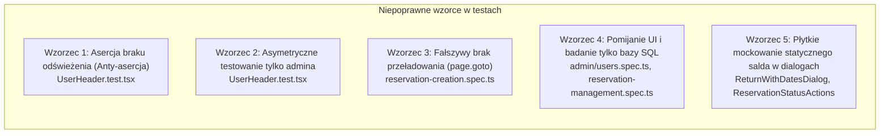

# Raport z dochodzenia: Problem synchronizacji salda godzinek (kredytów) w pasku górnym oraz oknie tworzenia rezerwacji

## 1. Cel i zakres badania

Zbadano problem opóźnionej synchronizacji i nieaktualnej wartości salda godzinek (kredytów użytkownika) w:
1. Pasku górnym aplikacji ([`UserHeader.tsx`](file:///E:/bystrze/Magazyn/frontend/src/components/navigation/UserHeader.tsx#L54-L157) – element `header-credits-badge`),
2. Oknie / widoku podsumowania tworzenia rezerwacji ([`ReservationCartView.tsx`](file:///E:/bystrze/Magazyn/frontend/src/components/reservations/ReservationCartView.tsx#L50-L115) oraz modal [`ConfirmationModal.tsx`](file:///E:/bystrze/Magazyn/frontend/src/components/reservations/ConfirmationModal.tsx#L148-L163)).

W przeciwieństwie do powyższych komponentów, widok godzinek ([`CreditsTabs.tsx`](file:///E:/bystrze/Magazyn/frontend/src/components/credits/CreditsTabs.tsx) / [`CreditHistoryContainer.tsx`](file:///E:/bystrze/Magazyn/frontend/src/components/credits/CreditHistoryContainer.tsx)) natychmiast wyświetla poprawną, zaktualizowaną wartość.

Badanie obejmuje:
- Identyfikację przyczyny źródłowej (root cause) rozbieżności,
- Analizę wcześniejszej próby naprawy (commity `e1cda85` / PR #273 oraz `6d2dc04` / PR #264),
- Wskazanie testów stanowiących fałszywe pozytywy (false positives) oraz testów powielających niepoprawne wzorce asercji,
- Propozycję architektury docelowej (bez wprowadzania zmian w kodzie na tym etapie).

---

## 2. Architektura przepływu danych o saldzie

Poniższy diagram ilustruje, skąd poszczególne widoki pobierają dane o saldzie godzinek:

```mermaid
flowchart TD
    subgraph Database["PostgreSQL / Supabase"]
        DBProfiles[("profiles (credit_balance)")]
    end

    subgraph Backend["Go Backend (API)"]
        CreditService["creditHistoryService.GetCreditHistory()"]
        AuthSessionService["authService.GetSession()"]
        UserRepo["userRepo.GetByID() -> SQL direct"]
        AuthRepo["authRepo.GetProfile() -> PostgREST client"]
        
        CreditService --> UserRepo
        UserRepo --> DBProfiles
        AuthSessionService --> AuthRepo
        AuthRepo --> DBProfiles
    end

    subgraph CreditsView["Widok Godzinek (/credits)"]
        useCreditHistory["useCreditHistory() (TanStack Query)"]
        creditsApiHistory["creditsApi.getHistory()"]
        useCreditHistory --> creditsApiHistory
        creditsApiHistory -->|GET /api/credits/history| CreditService
        CreditService -->|Zawsze aktualne z bazy| useCreditHistory
    end

    subgraph TopBar["Pasek górny (UserHeader.tsx)"]
        AppLayoutSSR["Astro SSR (AppLayout.astro)"]
        SessionInfoProp["Prop: creditBalance={sessionInfo.creditBalance}"]
        UserHeaderEffect{"isAdmin?"}
        
        AppLayoutSSR -->|SSR snapshot| SessionInfoProp
        SessionInfoProp --> UserHeaderEffect
        UserHeaderEffect -->|NIE (zwykły user)| StaticDisplay["Wyświetla statyczny prop z SSR (brak odświeżania!)"]
        UserHeaderEffect -->|TAK (admin)| AdminFetch["creditsApi.getHistory()"]
    end

    subgraph ReservationDialog["Okno Rezerwacji (ReservationCartView + ConfirmationModal)"]
        CartSSR["create.astro: initialCreditBalance"]
        CartEffect{"isAdmin?"}
        
        CartSSR --> CartEffect
        CartEffect -->|TAK (admin)| AdminCartFetch["creditsApi.getHistory() (aktualne)"]
        CartEffect -->|NIE (zwykły user)| UserSessionFetch["fetch('/api/auth/session') (stale / brak invalidation)"]
        UserSessionFetch --> ConfirmationModal["ConfirmationModal (brak odświeżenia przed otwarciem)"]
    end
```

---

## 3. Dlaczego widok Godzinek działa poprawnie?

W widoku `/credits`:
1. Komponent [`CreditHistoryContainer.tsx`](file:///E:/bystrze/Magazyn/frontend/src/components/credits/CreditHistoryContainer.tsx#L13-L56) wywołuje hook [`useCreditHistory()`](file:///E:/bystrze/Magazyn/frontend/src/hooks/useCreditHistory.ts#L20-L56).
2. Hook wykonuje zapytanie za pośrednictwem TanStack Query:
   ```typescript
   queryFn: ({ pageParam = 1 }) => creditsApi.getHistory({ page: pageParam, perPage })
   ```
3. Zapytanie trafia do endpointu Go backendu `GET /credits/history` ([`HandleGetCreditHistory`](file:///E:/bystrze/Magazyn/backend/internal/handler/credit/credit_handler.go#L24-L49)).
4. Serwis backendowy [`creditHistoryService.GetCreditHistory`](file:///E:/bystrze/Magazyn/backend/internal/service/credit/credit_service.go#L48-L65):
   ```go
   userProfile, err := s.userRepo.GetByID(ctx, targetUserID)
   ```
   pobiera profil użytkownika **bezpośrednio z tabeli `profiles` w PostgreSQL** przy użyciu klienta serwisowego.
5. Zwracany obiekt `CreditHistoryResponse` zawiera pole `CurrentBalance: userProfile.CreditBalance`.
6. Każde wejście na stronę lub ponowne pobranie danych (refetch / un-stale) odczytuje natychmiast stan z bazy danych, dzięki czemu użytkownik widzi aktualny stan konta.

---

## 4. Analiza wcześniejszej próby naprawy (Poprzedni fix)

Problem był wcześniej diagnozowany i modyfikowany w commitach:
- `6d2dc04` (`fix(chunk-1): core reservation and credit balance logic (#2, #7, #9, #10) (#264)`),
- `e1cda85` (`fix: credit balance display reservation v2 (#273)`),
- `037a130` (`fix: update credit balance handling in UserHeader component`).

### Co zrobiono w `UserHeader.tsx`:
Wprowadzono kod:
```tsx
const [adminCreditBalance, setAdminCreditBalance] = useState<{
  userId: string | null;
  sessionBalance: number | undefined;
  balance: number;
}>();
const userId = user?.id ?? null;

useEffect(() => {
  if (!isAdmin) return; // <--- KARDYNALNY BŁĄD ARCHITEKTONICZNY

  let isMounted = true;
  creditsApi
    .getHistory({ page: 1, perPage: 25 })
    .then((history) => {
      if (isMounted) {
        setAdminCreditBalance({
          userId,
          sessionBalance: creditBalance,
          balance: history.currentBalance,
        });
      }
    })
    .catch((error) => {
      logger.error("Failed to refresh admin credit balance in header", { error });
    });

  return () => {
    isMounted = false;
  };
}, [creditBalance, isAdmin, userId]);

const displayedCreditBalance =
  isAdmin &&
  adminCreditBalance?.userId === userId &&
  adminCreditBalance.sessionBalance === creditBalance
    ? adminCreditBalance.balance
    : creditBalance;
```

**Błędy tej implementacji:**
1. **Wykluczenie zwykłych użytkowników**: Dodano klauzulę `if (!isAdmin) return;`. Oznacza to, że dla 100% zwykłych użytkowników efekt jest martwy – nie jest wysyłane żadne zapytanie o aktualizację salda.
2. **Statyczna wartość SSR**: Zwykły użytkownik otrzymuje wyłącznie wartość `creditBalance` przekazaną z szablonu Astro SSR ([`AppLayout.astro`](file:///E:/bystrze/Magazyn/frontend/src/layouts/AppLayout.astro#L55-L61)) w momencie renderowania strony HTML.
3. **Izolacja wyspowa (Astro Islands)**: `UserHeader` jest niezależną wyspą React (`client:load`). Nie subskrybuje żadnego globalnego stanu (React Query cache, custom events, storage events). Jeśli użytkownik wykona rezerwację, otrzyma doładowanie od admina lub zwrot – nagłówek o tym nie wie.
4. **Warunek `adminCreditBalance.sessionBalance === creditBalance`**: Sztuczny warunek, który powoduje, że gdy zmieni się prop sesyjny, pobrana wartość admina jest unieważniana.

### Co zrobiono w `ReservationCartView.tsx`:
Wprowadzono rozgałęzienie:
```tsx
React.useEffect(() => {
  let isMounted = true;

  if (isAdmin) {
    creditsApi
      .getHistory({ page: 1, perPage: 25 })
      .then((history) => {
        if (!isMounted) return;
        setUserCreditBalance(history.currentBalance);
        if (selectedUserIdRef.current === initialSelectedUserId) {
          setSelectedUserCreditBalance(history.currentBalance);
        }
      });
    return () => { isMounted = false; };
  }

  fetch("/api/auth/session")
    .then((r) => r.ok && r.json())
    .then((d) => {
      if (isMounted && typeof d?.creditBalance === "number") {
        setUserCreditBalance(d.creditBalance);
      }
    });
  return () => { isMounted = false; };
}, [initialSelectedUserId, isAdmin]);
```

**Błędy tej implementacji:**
1. **Dla admina użyto `creditsApi.getHistory()`**, co rozwiązało problem u admina.
2. **Dla użytkownika pozostawiono `fetch("/api/auth/session")`**:
   - `fetch("/api/auth/session")` odpytuje endpoint sesji Astro.
   - Astro middleware pobiera sesję Supabase z ciasteczek (`sb-magazyn-auth-token`).
   - Brak jakichkolwiek nagłówków `Cache-Control: no-cache, no-store` przy zapytaniu przeglądarkowym.
3. **Brak odświeżenia przed otwarciem modalu**: W funkcji `handleProceed()` przed wywołaniem `setIsConfirmationOpen(true)` saldo nie jest pobierane ani weryfikowane. Modal [`ConfirmationModal.tsx`](file:///E:/bystrze/Magazyn/frontend/src/components/reservations/ConfirmationModal.tsx#L148-L163) wyświetla `costBreakdown.currentBalance`, który bazuje na wartości pobranej raz przy montowaniu koszyka.

---

## 5. Dlaczego synchronizacja trwa „bardzo długo”?

Użytkownik zauważył, że synchronizacja w końcu następuje, ale trwa to bardzo długo. Wynika to z następujących mechanizmów:
1. **Brak invalidacji na poziomie klienta**: Żaden komponent kliencki nie wywołuje ponownego pobrania salda po operacjach mutujących.
2. **Cykl życia tokenu JWT Supabase (1 godzina)**: Tokeny sesyjne i ciasteczka odświeżają się w tle co godzinę (`TOKEN_REFRESHED` w [`AuthListener.tsx`](file:///E:/bystrze/Magazyn/frontend/src/components/auth/AuthListener.tsx#L90-L93)). Dopiero po re-autentykacji lub odświeżeniu tokenu przez Supabase sesja w Astro middleware zostaje zaktualizowana.
3. **Brak nasłuchiwania w nagłówku**: Ponieważ w `UserHeader` jest `if (!isAdmin) return;`, zwykły użytkownik nie pobierze nowego salda, dopóki nie nastąpi pełne przeładowanie dokumentu (F5) przy jednoczesnym zaktualizowaniu danych sesyjnych na serwerze.
4. **Cache nawigacyjny przeglądarki (bfcache)**: Przy standardowej nawigacji wstecz/wprzód przeglądarka przywraca stan DOM z pamięci podręcznej, zachowując stary nagłówek.

---

## 6. Weryfikacja testów i zidentyfikowane niepoprawne wzorce (False Positives & Anti-patterns)

Przeanalizowano wszystkie zestawy testów (jednostkowe, integracyjne, E2E). Zidentyfikowano 5 kluczowych wzorców anty-testowych, które dają fałszywe poczucie stabilności i maskują problem synchronizacji salda:



### Wzorzec 1: Asercja braku wywołania pobierania salda dla zwykłych użytkowników
* **Plik**: [`frontend/src/components/navigation/__tests__/UserHeader.test.tsx`](file:///E:/bystrze/Magazyn/frontend/src/components/navigation/__tests__/UserHeader.test.tsx#L58-L63)
* **Kod testu**:
  ```tsx
  it("keeps the session balance for regular users", () => {
    render(<UserHeader user={mockUser} currentPath="/reservations" creditBalance={75} />);

    expect(screen.getByTestId("header-credits-badge")).toHaveTextContent("Godzinki: 75");
    expect(getHistoryMock).not.toHaveBeenCalled();
  });
  ```
* **Dlaczego to błąd (False Positive)**:
  Test ten został wprowadzony w commicie `e1cda85`, aby sztucznie uzasadnić klauzulę `if (!isAdmin) return;`. Test wprost asertuje, że `getHistoryMock` **nie został wywołany**. W efekcie test chroni wadliwą implementację – poprawna naprawa synchronizacji dla zwykłych użytkowników spowoduje upadek tego testu, chyba że zostanie on przepisany na asercję poprawnego pobrania salda.

### Wzorzec 2: Testowanie odświeżania salda wyłącznie dla administratora
* **Plik**: [`frontend/src/components/navigation/__tests__/UserHeader.test.tsx`](file:///E:/bystrze/Magazyn/frontend/src/components/navigation/__tests__/UserHeader.test.tsx#L45-L56)
* **Kod testu**:
  ```tsx
  it("uses the credit history balance for admins", async () => {
    getHistoryMock.mockResolvedValue({ currentBalance: 24 });
    render(<UserHeader user={mockUser} currentPath="/reservations" creditBalance={1000} isAdmin />);
    await waitFor(() => {
      expect(screen.getByTestId("header-credits-badge")).toHaveTextContent("Godzinki: 24");
    });
    expect(getHistoryMock).toHaveBeenCalledWith({ page: 1, perPage: 25 });
  });
  ```
* **Dlaczego to błąd**:
  Zestaw testów weryfikuje asynchroniczną aktualizację wyłącznie przy fladze `isAdmin: true`. Pozwala to na osiągnięcie 100% pass rate modułu nawigacji, kompletnie ignorując fakt, że dla standardowych użytkowników (stanowiących większość ruchu) mechanizm w ogóle nie działa.

### Wzorzec 3: E2E deklarujące brak przeładowania strony, wykonujące pełny SSR reload
* **Plik**: [`frontend/e2e/tests/reservation-creation.spec.ts`](file:///E:/bystrze/Magazyn/frontend/e2e/tests/reservation-creation.spec.ts#L199-L255)
* **Kod testu**:
  ```typescript
  test("Reactive Balance: Sequential back-to-back reservations update credit balance in UI without page reload", async ({
    authenticatedPage,
    testEquipment,
    workerIndex,
  }) => {
    // Rezerwacja 1:
    await cart.proceedToConfirmation();
    await cart.confirm();
    await cart.waitForSuccess();

    // Rezerwacja 2 w TEJ SAMEJ sesji:
    await authenticatedPage.goto("/equipment"); // <--- PEŁNE PRZEŁADOWANIE W PLAYWRIGHT
    await addToCart(authenticatedPage, equip2.id);
    await goToCart(authenticatedPage);         // <--- KOLEJNE PEŁNE PRZEŁADOWANIE (goto /reservations/create)
    await cart.waitForCartView();

    const secondCartInitialBalance = await cart.getCurrentBalance();
    expect(secondCartInitialBalance).toBe(expectedBalanceAfterRes1);
  ```
* **Dlaczego to błąd**:
  Tytuł testu obiecuje weryfikację reaktywności *„without page reload”*. Jednak metoda `page.goto()` w Playwright wykonuje twarde zapytanie HTTP GET do serwera Astro, wymuszając pełny cykl SSR middleware! Test w ogóle nie weryfikuje reaktywnego odświeżania salda w aplikacji SPA ani nie sprawdza nagłówka (`header-credits-badge`). Test przechodzi na zielono, maskując rzeczywistą niespójność.

### Wzorzec 4: Weryfikacja operacji kredytowych wyłącznie w bazie danych z pominięciem interfejsu (UI)
* **Pliki**:
  1. [`frontend/e2e/tests/admin/users.spec.ts`](file:///E:/bystrze/Magazyn/frontend/e2e/tests/admin/users.spec.ts#L170-L205):
     ```typescript
     await adminUsersPage.adjustUserCredits(targetUserEmail, 25, ...);
     const { data: profile } = await supabaseAdmin.from("profiles").select("credit_balance").eq("id", targetUserId).single();
     expect(profile?.credit_balance).toBe(125);
     ```
  2. [`frontend/e2e/tests/admin/reservation-management.spec.ts`](file:///E:/bystrze/Magazyn/frontend/e2e/tests/admin/reservation-management.spec.ts#L158-L180) oraz linie 219–260:
     ```typescript
     const { data: profileBefore } = await supabaseAdmin.from("profiles").select("credit_balance")...;
     // operacja anulowania / rezerwacji darmowej ...
     const { data: profileAfter } = await supabaseAdmin.from("profiles").select("credit_balance")...;
     ```
* **Dlaczego to błąd**:
  Testy sprawdzają wyłącznie stan w PostgreSQL. Ani razu nie weryfikują, czy użytkownik w przeglądarce widzi zaktualizowany stan w pasku górnym (`header-credits-badge`), w koszyku (`current-credit-balance`), czy w oknie potwierdzenia (`confirmation-current-balance`). Błędy synchronizacji frontendowej są całkowicie niewidoczne dla tych testów.

### Wzorzec 5: Płytkie mockowanie salda w testach okien dialogowych i brak asercji wartości w podsumowaniu
* **Pliki**:
  1. [`frontend/src/components/reservations/__tests__/ReturnWithDatesDialog.test.tsx`](file:///E:/bystrze/Magazyn/frontend/src/components/reservations/__tests__/ReturnWithDatesDialog.test.tsx#L31-L157):
     Komponent otrzymuje na sztywno `currentUserBalance={10}` lub `currentUserBalance={100}` jako statyczny prop. Brak testu weryfikującego reakcję na zmianę salda lub pobranie aktualnego salda.
  2. [`frontend/src/components/reservations/__tests__/ReservationStatusActions.test.tsx`](file:///E:/bystrze/Magazyn/frontend/src/components/reservations/__tests__/ReservationStatusActions.test.tsx#L52):
     Przekazuje twardo zakodowaną wartość `currentUserBalance={100}`.
  3. [`frontend/e2e/tests/reservation-creation.spec.ts`](file:///E:/bystrze/Magazyn/frontend/e2e/tests/reservation-creation.spec.ts#L112-L118) – w teście `Happy Path`:
     ```typescript
     await expect(authenticatedPage.getByTestId(TEST_IDS.CONFIRMATION_CURRENT_BALANCE)).toBeVisible();
     await expect(authenticatedPage.getByTestId(TEST_IDS.CONFIRMATION_REMAINING_BALANCE)).toBeVisible();
     ```
     Test sprawdza jedynie **widoczność** selektorów, nie weryfikując, czy wyświetlona wartość liczbowa odpowiada rzeczywistemu stanowi konta użytkownika.

---

## 7. Podsumowanie i plan naprawy dla testów

Aby testy rzeczywiście chroniły aplikację przed powrotem problemu niespójności salda, plan wdrożenia musi objąć:

1. **Przepisanie testu jednostkowego `UserHeader.test.tsx`**:
   - Usunięcie testu `keeps the session balance for regular users`.
   - Dodanie testu `uses the credit history balance for all authenticated users` (sprawdzającego zarówno `isAdmin: true`, jak i `isAdmin: false`).
2. **Korekta testu E2E `reservation-creation.spec.ts`**:
   - Wprowadzenie asercji sprawdzających `header-credits-badge` przed i po utworzeniu rezerwacji.
   - Wprowadzenie asercji sprawdzających rzeczywistą wartość liczbową w `confirmation-current-balance` i `confirmation-remaining-balance` w modalu.
   - Dodanie prawdziwego testu reaktywności w ramach sesji (np. weryfikacja aktualizacji nagłówka bez pełnego przeładowania URL).
3. **Uzupełnienie stałych testowych `TEST_IDS`**:
   - Dodanie `HEADER_CREDITS_BADGE: "header-credits-badge"` oraz `CURRENT_CREDIT_BALANCE: "current-credit-balance"` do [`test-ids.ts`](file:///E:/bystrze/Magazyn/frontend/e2e/constants/test-ids.ts).
4. **Weryfikacja UI w testach administracyjnych `admin/users.spec.ts`**:
   - Rozszerzenie testu audytowanego doładowania o sprawdzenie widoku użytkownika (lub nagłówka), a nie tylko bazy danych.
