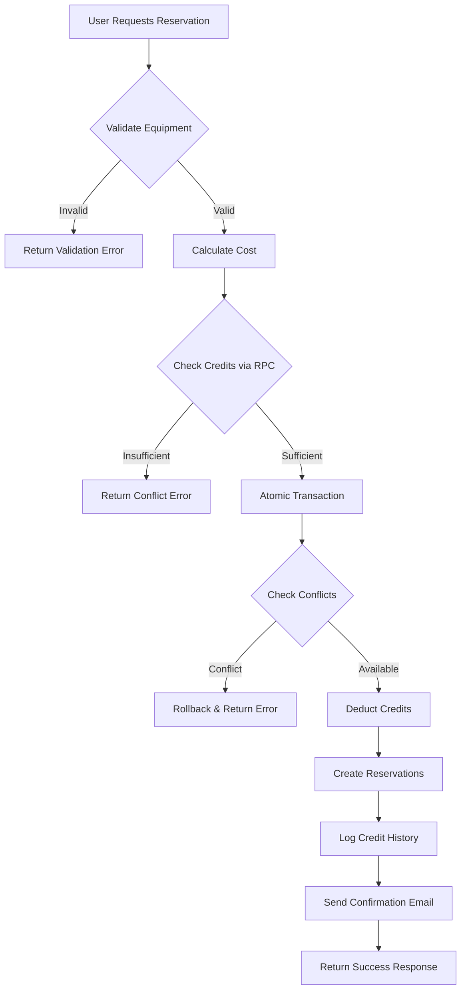
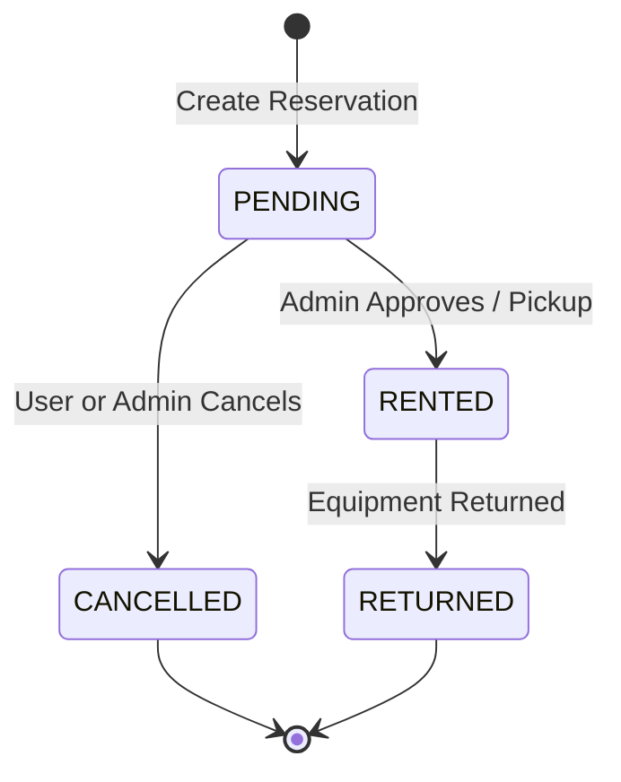
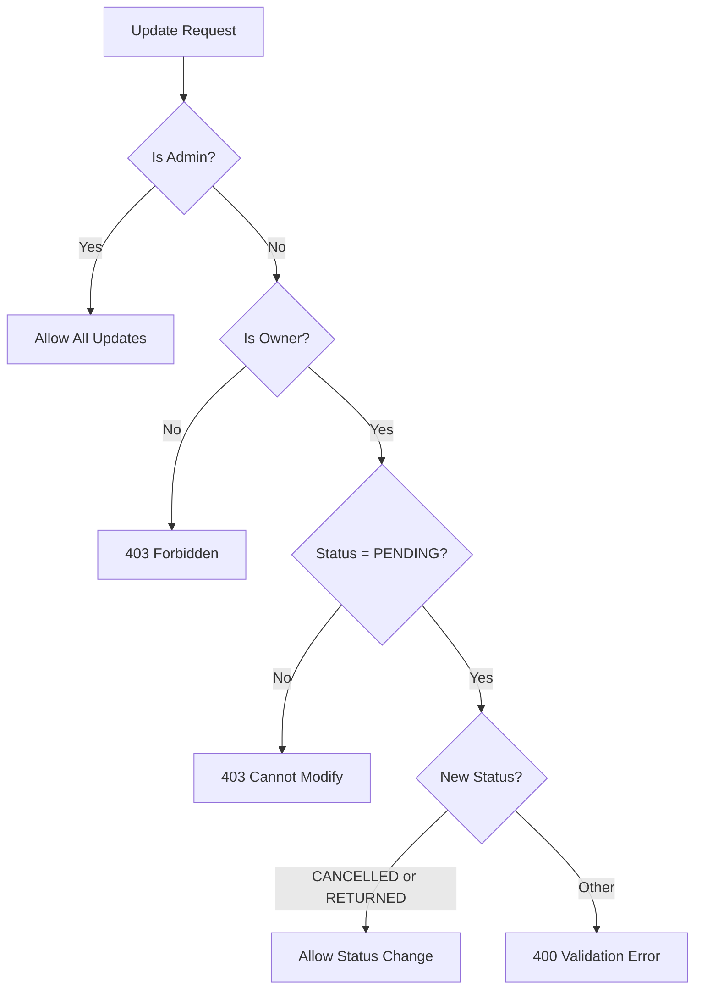

# Reservation Workflow

This document describes the complete reservation workflow, including logic flow, cost calculation, status transitions, and failure handling.

## Overview

The reservation system manages equipment rentals with credit-based billing. Users spend credits from their balance to reserve equipment, and credits are refunded on cancellation.



---

## Cost Calculation

### Formula

```
Cost = Days × CreditCostPerDay (from EquipmentType)
```

### Day and Cost Calculation Logic

Day calculation is located in `backend/internal/validation/date.go`:

**Rules:**

- Dates are in `YYYY-MM-DD` format
- Minimum charge is **1 day**
- Total includes both start and end date (`days + 1`)
- Cost per day is defined per `EquipmentType`, not per individual equipment

### Example

| Start Date | End Date   | Days | Cost/Day  | Total Cost |
| ---------- | ---------- | ---- | --------- | ---------- |
| 2025-01-01 | 2025-01-03 | 3    | 5 credits | 15 credits |
| 2025-01-05 | 2025-01-05 | 1    | 5 credits | 5 credits  |

---

## Reservation Status Lifecycle

Statuses are defined in `backend/internal/constants/constants.go`:

| Status      | Description                                              |
| ----------- | -------------------------------------------------------- |
| `PENDING`   | Reservation created, awaiting equipment pickup           |
| `RENTED`    | Equipment currently with user                            |
| `RETURNED`  | Equipment returned, reservation complete                 |
| `CANCELLED` | Reservation cancelled by user or admin, credits refunded |

### Status Transition Diagram



### Permission-Based Transitions

| Actor | From Status | Allowed Transitions                                 |
| ----- | ----------- | --------------------------------------------------- |
| User  | `PENDING`   | → `CANCELLED` (cancel own), `RETURNED` (return own) |
| Admin | `PENDING`   | → `RENTED`, `CANCELLED`                             |
| Admin | `RENTED`    | → `RETURNED`                                        |

> [!IMPORTANT]
> Users can only modify their **own PENDING** reservations (transitioning to `CANCELLED` or `RETURNED`). Non-pending reservations are immutable for regular users.

---

## Create Reservation Flow

The creation pipeline is orchestrated by `backend/internal/service/reservation/reservation_service_create.go` and executed via `backend/internal/repository/supabase/reservation_repository_rpc.go` (`CreateReservationsAtomic`).

### Step-by-Step Process

1. **Target User Resolution**
   - Admin can create for any user (via `cmd.UserID`)
   - Regular users always create for themselves

2. **Validation Phase** (Read-Only)
   - For each reservation item:
     - Verify equipment exists
     - Check equipment is not archived (`is_archived = false`)
     - Check equipment status is not `BROKEN`
     - Fetch equipment type for cost calculation
     - Calculate item cost: `days × credit_cost_per_day`
   - Sum total cost

3. **Atomic Transaction** (via DB RPC)
   - Calls `create_reservation_atomic` PostgreSQL function (see [Database Documentation](../database/db-doc.md#create_reservation_atomic))
   - Steps within transaction:
     1. Lock user row (`FOR UPDATE`)
     2. Verify sufficient balance
     3. Deduct credits from profile
     4. Log deduction in `credit_history`
     5. For each reservation:
        - Check for overlapping reservations (`PENDING` or `RENTED`)
        - Insert reservation with status `PENDING`
     6. Return created IDs and new balance

4. **Email Notification** (Async)
   - Runs in background goroutine
   - Uses detached context to prevent request cancellation issues
   - Currently a no-op implementation logging to console

5. **Response**
   - Returns created reservation IDs
   - Total credit cost
   - Remaining balance

---

## Update Reservation Flow

The update, date modification, and cancellation lifecycle is orchestrated by `backend/internal/service/reservation/reservation_service_update.go` and executed via `backend/internal/repository/supabase/reservation_repository_rpc.go` (`ModifyReservationDatesWithCredits`, `RefundCredits`).

### Authorization Checks



### Status Change to CANCELLED (Cancellation)

When status changes to `CANCELLED`:

1. Fetch equipment details
2. Fetch equipment type for cost calculation
3. Calculate refund: `days × credit_cost_per_day`
4. Call `refund_reservation_credits` RPC (see [Database Documentation](../database/db-doc.md#refund_reservation_credits))
   - Updates user's `credit_balance`
   - Logs refund in `credit_history` with reason `reservation_refund`

### Date Change

When dates are modified:

1. Check for overlapping reservations (excluding current)
2. If conflicts exist, return `409 Conflict`
3. Update reservation dates
4. **Credit Recalculation:** Handled atomically via `modify_reservation_dates_with_credits` RPC, which calculates difference in days/credits, validates balance, updates `credit_history`, and skips adjustment for free reservations.

---

## Failure Handling

### Validation Errors (HTTP 400)

| Condition                          | Error Message                                          |
| ---------------------------------- | ------------------------------------------------------ |
| Equipment not found                | `Equipment {id} not found`                             |
| Equipment archived/broken          | `Equipment {name} is not available`                    |
| User tries non-cancellation status | `Users can only cancel or return pending reservations` |

### Authorization Errors (HTTP 403)

| Condition                      | Error Message                                  |
| ------------------------------ | ---------------------------------------------- |
| User views other's reservation | `You are not allowed to view this reservation` |
| User modifies non-own          | `Not allowed`                                  |
| User modifies non-pending      | `Cannot modify non-pending reservation`        |

### Conflict Errors (HTTP 409)

| Condition               | Error Message                                              |
| ----------------------- | ---------------------------------------------------------- |
| Insufficient credits    | `Reservation failed: Insufficient credits`                 |
| Date overlap (creation) | `Reservation failed: Conflict detected for equipment {id}` |
| Date overlap (update)   | `Dates not available`                                      |

### Database-Level Failures

The RPC function uses `SECURITY DEFINER` and PostgreSQL transactions to ensure:

- **Atomicity:** All-or-nothing execution
- **Isolation:** Row-level locking prevents concurrent balance modifications
- **Consistency:** Rollback on any failure

| Exception              | Behavior               |
| ---------------------- | ---------------------- |
| `User not found`       | Transaction rolls back |
| `Insufficient credits` | Transaction rolls back |
| `Conflict detected`    | Transaction rolls back |

### Refund Failure Handling

Refund failures are **logged but not blocking**:

```go
if err := s.repo.RefundCredits(ctx, id, refundAmount); err != nil {
    logger.Errorf(ctx, "Failed to refund %d credits for reservation %s: %v", refundAmount, id, err)
} else {
    logger.Infof(ctx, "Refunded %d credits for reservation %s", refundAmount, id)
}
```

> [!WARNING]
> If refund fails, the reservation status change **still proceeds**. Manual intervention may be required.

---

## Database Functions Reference

### `create_reservation_atomic`

| Parameter              | Type    | Description                                       |
| ---------------------- | ------- | ------------------------------------------------- |
| `p_user_id`            | UUID    | User creating reservations                        |
| `p_total_cost`         | INTEGER | Pre-calculated total credit cost                  |
| `p_is_free`            | BOOLEAN | Whether reservations are free (charges 0 credits) |
| `p_created_by_user_id` | UUID    | Creator/actor user ID                             |
| `p_reservations`       | JSONB   | Array of `{equipment_id, start_date, end_date}`   |

**Returns:** `{reservation_ids: UUID[], new_balance: INTEGER}`

### `modify_reservation_dates_with_credits`

| Parameter              | Type | Description                  |
| ---------------------- | ---- | ---------------------------- |
| `p_reservation_id`     | UUID | Reservation being modified   |
| `p_changed_by_user_id` | UUID | User requesting modification |
| `p_new_start_date`     | DATE | New start date               |
| `p_new_end_date`       | DATE | New end date                 |

**Returns:** JSONB object containing updated reservation fields, cost differences, and new balance

### `refund_reservation_credits`

| Parameter          | Type    | Description             |
| ------------------ | ------- | ----------------------- |
| `p_reservation_id` | UUID    | Reservation to refund   |
| `p_amount`         | INTEGER | Credit amount to refund |

**Returns:** void

---

## Related Files

| File | Purpose |
| :--- | :--- |
| `backend/internal/service/reservation/reservation_service.go` | Main service interface, constructor, list, get, and bulk updates |
| `backend/internal/service/reservation/reservation_service_create.go` | Reservation creation validation, pricing orchestration, and atomic RPC dispatch |
| `backend/internal/service/reservation/reservation_service_update.go` | Reservation update, date conflict checks, cancellation, and refund logic |
| `backend/internal/service/reservation/pricing.go` | Pure pricing calculations (`CalculateReservationCost`) |
| `backend/internal/validation/date.go` | Inclusive date span calculation (`CalculateDays`) and ISO validation |
| `backend/internal/repository/supabase/reservation_repository_rpc.go` | Atomic PostgreSQL stored procedure wrappers (`create_reservation_atomic`, `modify_reservation_dates_with_credits`, `refund_reservation_credits`) |
| `backend/internal/repository/supabase/reservation_repository_query.go` | Filtered list retrieval and RLS bypass logic |
| `backend/internal/repository/supabase/reservation_repository_detail.go` | Detailed queries joining user profiles and equipment |
| `backend/internal/repository/supabase/reservation_repository_stats.go` | Aggregates for dashboard statistics |
| `backend/internal/handler/reservation/reservation_query.go` | Query parameter extraction and validation binder |
| `backend/internal/handler/reservation/reservation_admin_handler.go` | Dedicated administrative handlers for dashboard metrics and bulk actions |
| `backend/internal/constants/constants.go` | Status constants and date formats |
| `supabase/migrations/20260314183802_add_is_free_to_reservations.sql` | Atomic reservation RPCs and `is_free` support |
| `backend/internal/service/email/email_service.go` | Email service (Noop implementation) |
| `frontend/src/hooks/useCartCheckout.ts` | Frontend cart checkout mutation and credit sufficiency checks |
| `frontend/src/hooks/useReservationDateAdjustment.ts` | Frontend date adjustment mutation and range validation |
| `frontend/src/hooks/useReservationDialogs.ts` | Frontend modal dialog state management |
