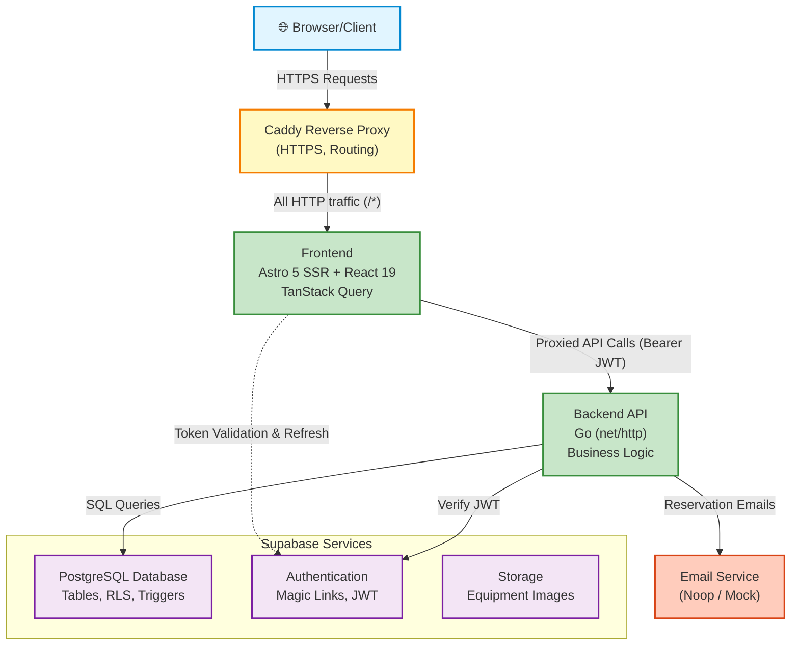

# High-Level Architecture

This diagram shows the main components of the Magazyn application and their interactions.

## Key Components

### Browser/Client

- User interface
- Interacts with frontend via HTTPS
- Receives server-rendered pages and React components
- Stores single encrypted `HttpOnly` session cookie (`magazyn_sid`)

### Caddy Reverse Proxy

- Automatic HTTPS (Let's Encrypt / TLS certificates)
- Routes all incoming traffic (`/*`) to Frontend (Astro SSR) container

### Frontend (Astro + React)

- **Astro 5**: SSR pages, layouts, server-side encrypted HttpOnly session management middleware
- **React 19**: Interactive components (cart, calendar, forms)
- **TanStack Query**: Server state management and caching
- **API Proxies**: Server-side proxy endpoints (`/api/*`) that unwrap session cookies and forward requests to backend with Bearer JWT auth headers

### Backend (Go)

- RESTful API
- Layered architecture (Handler → Service → Repository)
- JWT verification via Supabase
- Business logic (reservations, credits, equipment)
- Reservation email notifications via Noop email service

### Supabase Services

#### PostgreSQL Database

- User profiles, equipment, reservations
- Credit system (history, requests)
- Row Level Security (RLS) policies
- Triggers and stored procedures

#### Authentication

- Magic link (passwordless) authentication
- JWT token generation and validation
- Session management

#### Storage

- Equipment images
- Equipment image assets stored in bucket; referenced by backend equipment records
- RLS policies for secure access

### Email Service (Noop)

- Reservation confirmation emails (mocked via NoopEmailService in development)
- NOT used for authentication (Supabase handles all auth)

## Data Flow

1. **User Request** → Browser sends HTTPS request
2. **Routing** → Caddy routes to Frontend or Backend
3. **Frontend Processing** → Astro renders pages, React handles interactivity
4. **API Calls** → Frontend proxies call Backend with auth tokens
5. **Business Logic** → Backend processes requests, validates, applies logic
6. **Database Operations** → Backend queries PostgreSQL via Supabase
7. **Response** → Data flows back through layers to browser
